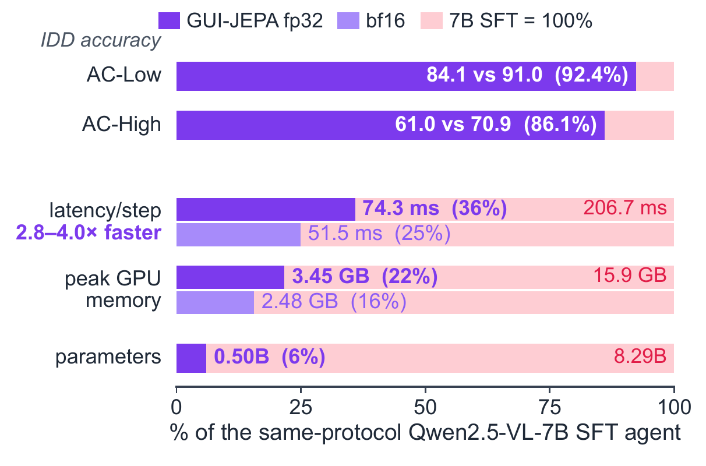
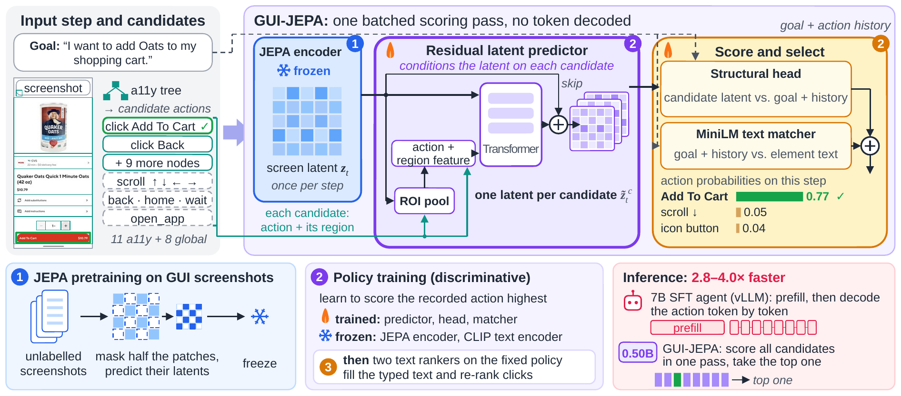
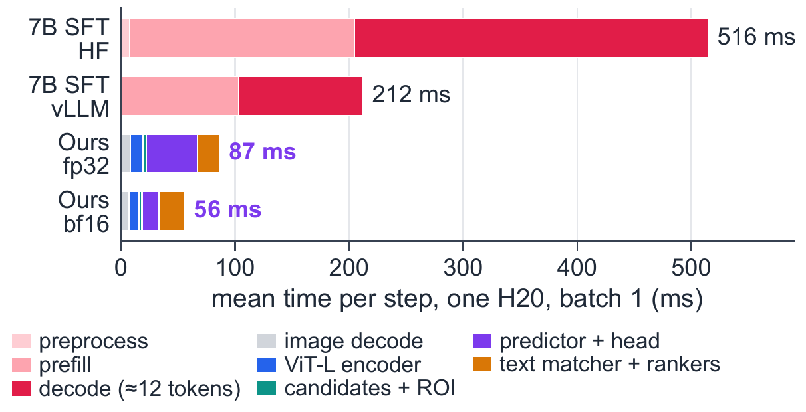
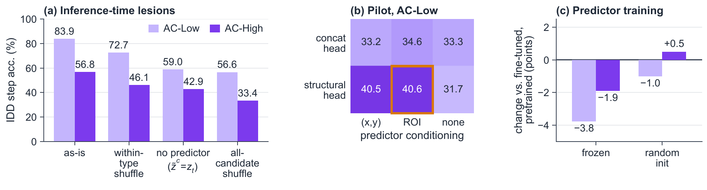
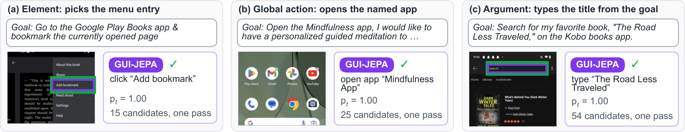

<div align="center">

<h1>GUI-JEPA</h1>

<h3>Candidate-Conditioned JEPA Latents as a Fast Action Policy for Mobile GUI Agents</h3>

<p>
  <a href="https://arxiv.org/abs/2610.36877"></a>
  <a href="https://arxiv.org/pdf/2610.36877"></a>
  <a href="LICENSE"></a>
  
  
</p>

<p>
  <b>Bingchao Wang</b><sup>1,2</sup>, <b>Yongcheng Jing</b><sup>2</sup>, <b>Shunyu Liu</b><sup>2</sup>, <b>Chengyu Wang</b><sup>3</sup>, <b>Jun Huang</b><sup>3</sup>,<br>
  <b>Jie Yang</b><sup>1&dagger;</sup>, <b>Wei Liu</b><sup>1&dagger;</sup>, <b>Dacheng Tao</b><sup>2&dagger;</sup>
</p>
<p>
  <sup>1</sup>Shanghai Jiao Tong University &nbsp;&nbsp; <sup>2</sup>Nanyang Technological University &nbsp;&nbsp; <sup>3</sup>Alibaba Cloud Computing<br>
  <sup>&dagger;</sup>Corresponding authors
</p>

<p>
  <a href="#-highlights">Highlights</a> ·
  <a href="#-method">Method</a> ·
  <a href="#-results">Results</a> ·
  <a href="#-getting-started">Getting Started</a> ·
  <a href="#-citation">Citation</a>
</p>



</div>

**GUI-JEPA** is a decoder-free action policy for mobile GUI agents. Instead of decoding every action
token by token with a 7B vision-language model, it embeds the screenshot once with a JEPA encoder
pretrained on unlabelled GUI screenshots, turns that screen latent into **one latent per candidate action**,
and **scores all candidates in a single batched pass**. On AndroidControl it runs **2.8–4.0× faster** than a
Qwen2.5-VL-7B agent fine-tuned with the same inputs, on the same GPU, while reaching **86–92% of its
in-distribution accuracy with 6% of its parameters**.

## 🔥 News

- **[2026/10]** Code released.
- **[2026/10]** Paper released on [arXiv](https://arxiv.org/abs/2610.36877).

## ✨ Highlights

- 🧠 **Score, don't decode.** To our knowledge, GUI-JEPA is the first GUI agent whose policy is built on a
  JEPA: it selects actions by scoring candidate-conditioned JEPA latents, with no decoder and no
  generative model in the loop.
- ⚡ **Fast and light.** 74.3 ms per step in fp32 and 51.5 ms in bf16, against 206.7 ms for the 7B agent
  served with vLLM (median over 100 shared real steps, one H20, batch 1), with 4.6–6.4× less peak GPU memory.
- 🪶 **Small.** 0.50B parameters in total (366M of them frozen), 6.0% of the 7B agent, reaching
  92.4% / 86.1% of its AC-Low / AC-High accuracy.
- 🔬 **A JEPA policy needs no dynamics pretraining.** The scorer relies on the latent pathway, and a randomly
  initialised predictor does as well as one pretrained on screen dynamics: the predictor is trained for the decision.

## 🧩 Method

<p align="center">
  
</p>

At each step GUI-JEPA enumerates the executable actions from the accessibility tree (one click per
element, one `input_text` per editable element, and the global actions: four scroll directions,
`navigate_back`, `navigate_home`, `wait`, `open_app`) and then:

1. **JEPA encoder.** A frozen ViT-L/16, pretrained with a JEPA objective on 189K unlabelled mobile and desktop
   screenshots (0.76 GPU-hours), embeds the screenshot once into the screen latent $z_t \in \mathbb{R}^{196\times1024}$.
2. **Residual latent predictor.** A 39.9M predictor conditioned on each candidate's action vector and
   region of interest turns the screen latent into one candidate-conditioned latent per candidate,
   $\tilde z^c = z_t + \Delta(z_t, a_c, \mathrm{roi}(c))$, all candidates in one batch.
3. **Score and select.** A cosine **structural head** scores every candidate-conditioned latent against the
   instruction (CLIP text embedding plus action history), a 33M **MiniLM text matcher** adds a score for each
   element's text, and the policy takes the argmax:

$$
s(c) = \kappa \cos\big(\mathrm{MLP}_v([\mathrm{pool}_{\mathrm{roi}(c)}(\tilde z^c);\ \mathrm{mean}(\tilde z^c)]),\ \mathrm{MLP}_t(\mathrm{cond})\big) + b_{\mathrm{type}(c)} + s_{\mathrm{text}}(c), \qquad \hat c = \arg\max_c s(c).
$$

4. **Text rankers.** A goal-source **span ranker** (22.7M) fills the typed text of `input_text`, and a
   **type-gated click reranker** (33.5M) re-scores the click candidates when the policy picks a click.

Training has three stages: (1) JEPA pretraining of the encoder, (2) policy training with a listwise
cross-entropy over the candidates of each step, and (3) the two text rankers on the fixed policy.

## 📊 Results

### Same inputs, same judge, same GPU (AndroidControl, IDD)

Both systems receive the same screenshot, accessibility-tree candidates and ground-truth action history,
and are scored by the same exact-match judge on the same 716 IDD episodes (3,858 steps).

| System | Params | AC-Low | AC-High | ms / step (p50) | Peak memory |
|:--|--:|--:|--:|--:|--:|
| Qwen2.5-VL-7B, LoRA SFT (HF transformers) | 8.29B | 91.01 | 70.87 | 506.7 | 15.9 GB |
| Qwen2.5-VL-7B, LoRA SFT (vLLM) | 8.29B | 91.01 | 70.87 | 206.7 | ≥16 GB |
| **GUI-JEPA** | **0.50B** | **84.06** | **60.99** | **74.3 / 51.5** | **3.45 / 2.48 GB** |

<sub>GUI-JEPA latency and memory: fp32 / bf16 autocast; accuracies in fp32. The bf16 pipeline makes the same predictions as fp32 on all 200 timed steps.</sub>

On the full AndroidControl test set (1,543 episodes, 8,444 steps) GUI-JEPA reaches **78.64 / 53.75** (AC-Low / AC-High).

### Where the time goes

<p align="center">
  
</p>

Decoding takes half or more of the 7B agent's step, and its prefill alone outlasts a whole GUI-JEPA step,
so the speed-up comes from both the smaller model and the absence of decoding. GUI-JEPA's cost grows with
the number of candidates, not with the length of an output.

| System | Serving | p50 (ms) | p90 (ms) | Peak memory | GUI-JEPA speed-up (fp32 / bf16) |
|:--|:--|--:|--:|--:|--:|
| 7B SFT, merged | HF transformers | 506.7 | 588.9 | 15.9 GB | 6.8× / 9.8× |
| 7B SFT, merged | vLLM | 206.7 | 247.9 | ≥16 GB | **2.8× / 4.0×** |
| GUI-JEPA, fp32 | PyTorch | 74.3 | 127.8 | 3.45 GB | – |
| GUI-JEPA, bf16 | PyTorch | 51.5 | 79.7 | 2.48 GB | – |

<sub>Same 100 real AC-High IDD steps, one NVIDIA H20, batch 1. Screenshot capture and accessibility-tree retrieval are excluded for both systems.</sub>

### Gains from the two text rankers (AC-High)

| Stage | IDD | Full test | OOD union | Validation |
|:--|--:|--:|--:|--:|
| Base policy | 56.84 | 49.79 | 43.85 | 57.54 |
| + span ranker | 59.69 | 52.44 | 46.34 | 60.43 |
| **+ click reranker** | **60.99** | **53.75** | **47.67** | **62.46** |

### The scorer relies on the latent pathway, which is trained for the decision

<p align="center">
  
</p>

- **Lesions (a).** Shuffling the candidates' action inputs costs 27.2 / 23.4 IDD points (Low / High);
  removing the predictor costs 24.9 / 14.0, mostly on the global actions.
- **Initialisation (c).** A randomly initialised predictor trained with the identical recipe matches the
  dynamics-pretrained one (+0.50 High / −1.01 Low), so a JEPA policy for GUIs needs no dynamics pretraining.

### Examples

<p align="center">
  
</p>

## 🚀 Getting Started

### Installation

```bash
git clone https://github.com/bcwang-sjtu/GUI-JEPA.git
cd GUI-JEPA
conda create -n gui-jepa python=3.11 -y && conda activate gui-jepa
pip install -r requirements.txt
```

### Data

| Data | Used for | Source |
|:--|:--|:--|
| AndroidControl | policy training and evaluation | `gs://gresearch/android_control` (TFRecord shards, `splits.json`, `test_subsplits.json`) |
| GUI-Odyssey | encoder pretraining (mobile screenshots) | [GUI-Odyssey](https://github.com/OpenGVLab/GUI-Odyssey) |
| VideoCUA | encoder pretraining (desktop frames) | VideoCUA (see the paper); extract frames with `scripts/preprocess/extract_videocua_frames.py` |

```bash
export AC=/path/to/android_control          # TFRecord shards + splits.json + test_subsplits.json
export PRETRAIN=/path/to/pretrain_screens   # GUI-Odyssey screenshots and VideoCUA frames (any folder tree)
export CACHE=/path/to/ac_cache              # feature cache written below
export CKPT=/path/to/checkpoints
SHARDS="$AC/android_control-*-of-*"
```

### Stage 1: JEPA pretraining of the encoder

```bash
python scripts/pretrain_encoder.py --data $PRETRAIN --out $CKPT/encoder
# ViT-L/16 (ImageNet init), random 50% patch masking, EMA 0.996, batch 96, 2 epochs -> encoder_1.pt
```

### Cache AndroidControl

```bash
python scripts/preprocess/dump_texts.py --shards "$SHARDS" --splits $AC/splits.json --out-dir $CACHE
python scripts/preprocess/dump_candidate_texts.py --shards "$SHARDS" --out $CACHE/cand_texts.json
python scripts/preprocess/build_cache.py --shards "$SHARDS" --splits-dir $AC \
    --encoder-ckpt $CKPT/encoder/encoder_1.pt --out $CACHE
```

The encoder runs once here; policy training reads the cached patch tokens and never runs the backbone.

### Stage 2: policy training

```bash
# predictor initialisation (optional: --fresh-predictor below does as well)
python scripts/pretrain_dynamics.py --cache $CACHE --out $CKPT/dynamics
# base policy: residual predictor + structural head + MiniLM text matcher, 6 epochs, one model for Low and High
python scripts/train_policy.py --cache $CACHE --init-predictor $CKPT/dynamics/predictor.pt \
    --out $CKPT/policy --seed 3
```

### Stage 3: text rankers

```bash
python scripts/train_span_ranker.py --cache $CACHE --out $CKPT/span_ranker
python scripts/click_reranker.py build --cache $CACHE --out $CACHE/click_reranker_train.pt
python scripts/click_reranker.py train --data $CACHE/click_reranker_train.pt --out $CKPT/click_reranker --seed 3
```

### Evaluation

```bash
python scripts/train_policy.py --cache $CACHE --eval-only --ckpt-dir $CKPT/policy \
    --span-ranker $CKPT/span_ranker --click-reranker $CKPT/click_reranker \
    --subsplit IDD --out outputs/eval_IDD
# --subsplit full | app_unseen | task_unseen | category_unseen   (OOD subsplits: add --subsplits-json $AC/test_subsplits.json)
# --eval-split validation                                       (validation split)
```

> [!NOTE]
> Run from the original checkpoints, this release reproduces the paper's IDD results exactly
> (final system: 84.06 AC-Low / 60.99 AC-High).

`results.json` reports step accuracy, type accuracy and click grounding for AC-Low (step instruction)
and AC-High (goal only). The judge keeps the original click rule (the chosen candidate's centre lies inside
the ground-truth element box), requires the normalised typed text to match, accepts no equivalent actions,
and counts clicks without an enumerated candidate as errors.

### Latency benchmark

```bash
python baselines/qwen25vl_sft/prepare_splits.py --cache $CACHE --out $CACHE/sft_prep
python scripts/preprocess/export_screenshots.py --shards "$SHARDS" --eids $CACHE/sft_prep/eids_all.json --out $CACHE/images
python scripts/benchmark_latency.py --cache $CACHE --images $CACHE/images \
    --encoder-ckpt $CKPT/encoder/encoder_1.pt --ckpt-dir $CKPT/policy \
    --span-ranker $CKPT/span_ranker --click-reranker $CKPT/click_reranker \
    --n-steps 100 --out outputs/latency_fp32.json          # add --bf16 for bf16 autocast
```

### Mechanism analyses

| Analysis | Flags for `scripts/train_policy.py` |
|:--|:--|
| No predictor at evaluation ($\tilde z^c := z_t$) | `--eval-only --identity-predictor` |
| Shuffle action inputs across all candidates / within a type | `--eval-only --shuffle-actions all` / `within_type` |
| Identity map in place of the predictor, retrained | `--identity-predictor` (training) |
| Randomly initialised predictor | `--fresh-predictor` |
| Frozen dynamics-pretrained predictor | `--freeze-predictor` (evaluate with `--init-predictor`) |
| Text matcher only | `--no-latent` |

### Same-protocol Qwen2.5-VL-7B reference

```bash
B=baselines/qwen25vl_sft; M=Qwen/Qwen2.5-VL-7B-Instruct; S=$CKPT/qwen_sft
python $B/build_train_data.py --cache $CACHE --prep $CACHE/sft_prep --images $CACHE/images --mode high --out $S/train_high.jsonl
python $B/train_lora.py --model $M --data $S/train_high.jsonl --out $S/lora_high
python $B/evaluate.py --model $M --adapter $S/lora_high/final --cache $CACHE --prep $CACHE/sft_prep \
    --images $CACHE/images --mode high --out $S/eval_high_idd.json      # --mode low for AC-Low
python $B/bench_latency_hf.py --model $M --adapter $S/lora_high/final --cache $CACHE --prep $CACHE/sft_prep \
    --images $CACHE/images --save-merged $S/merged_high --out $S/latency_hf.json
python $B/bench_latency_vllm.py --model $S/merged_high --cache $CACHE --prep $CACHE/sft_prep \
    --images $CACHE/images --no-prefix-caching --out $S/latency_vllm.json
```

## 📁 Repository Structure

```text
GUI-JEPA/
├── gui_jepa/
│   ├── actions.py            # candidate enumeration, 16-d action vectors
│   ├── models.py             # JEPA encoder loading, residual latent predictor, structural head, MiniLM matcher
│   ├── rankers.py            # type-gated click reranker
│   ├── roi.py                # ROI pooling over the 14x14 patch grid
│   ├── text_utils.py         # span enumeration, action history text, string matching
│   ├── clip_text.py          # frozen CLIP text encoder
│   ├── pretrain.py           # JEPA pretraining objective (stage 1)
│   └── data/                 # AndroidControl reader, feature cache, pretraining screenshots
├── scripts/
│   ├── preprocess/           # texts, candidate texts, feature cache, screenshots, VideoCUA frames
│   ├── pretrain_encoder.py   # stage 1
│   ├── pretrain_dynamics.py  # predictor initialisation
│   ├── train_policy.py       # stage 2 training, evaluation and mechanism analyses
│   ├── train_span_ranker.py  # stage 3
│   ├── click_reranker.py     # stage 3
│   └── benchmark_latency.py  # real-step serving latency
└── baselines/qwen25vl_sft/   # same-protocol Qwen2.5-VL-7B LoRA reference
```

## 📚 Citation

```bibtex
@article{wang2026guijepa,
  title   = {{GUI-JEPA}: Candidate-Conditioned {JEPA} Latents as a Fast Action Policy for Mobile {GUI} Agents},
  author  = {Wang, Bingchao and Jing, Yongcheng and Liu, Shunyu and Wang, Chengyu and Huang, Jun and Yang, Jie and Liu, Wei and Tao, Dacheng},
  journal = {arXiv preprint arXiv:2610.36877},
  year    = {2026}
}
```

## 🙏 Acknowledgements

GUI-JEPA builds on [I-JEPA](https://github.com/facebookresearch/ijepa),
[AndroidControl](https://github.com/google-research/google-research/tree/master/android_control),
[GUI-Odyssey](https://github.com/OpenGVLab/GUI-Odyssey), VideoCUA,
[timm](https://github.com/huggingface/pytorch-image-models),
[CLIP](https://github.com/openai/CLIP), [MiniLM / sentence-transformers](https://www.sbert.net/) and
[Qwen2.5-VL](https://github.com/QwenLM/Qwen2.5-VL). We thank their authors for releasing them.

## ⚖️ License

This project is released under the [MIT License](LICENSE). The datasets and pretrained models it uses
are subject to their own licenses.

## ⭐ Star History

[](https://www.star-history.com/#bcwang-sjtu/GUI-JEPA&Date)
